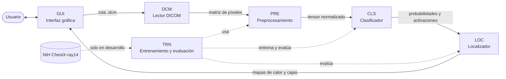

# Detección y localización de patologías torácicas en radiografías mediante Deep Learning

Proyecto de la asignatura **TEL328** (segundo semestre de 2026), Departamento de Electrónica, Universidad Técnica Federico Santa María.

El sistema recibe una radiografía de tórax en formato DICOM, la procesa con un modelo de Deep Learning y entrega las patologías probables junto con su ubicación aproximada sobre la imagen. El modelo se entrena con el dataset público NIH ChestX-ray14.

> [!IMPORTANT]
> Este sistema es una **herramienta de apoyo y prototipo académico**, no un dispositivo de diagnóstico. Cualquier resultado debe ser revisado por un profesional de la salud.

📄 **Documento completo:** [Análisis y Diseño, Hito 1](docs/pdi_hito_1.pdf)

## Contenido del repositorio

| Rama | Contenido |
| --- | --- |
| `main` | Este README y el documento de análisis y diseño del Hito 1 (`docs/pdi_hito_1.pdf`) |
| [`hito-2`](../../tree/hito-2) | Evidencias del Hito 2 en `evidencias/`: código, tests, capturas, logs, reportes, datos, videos y bitácora |

> [!NOTE]
> El video `evidencias/video/Gui(1).mp4` de la rama `hito-2` está almacenado con [Git LFS](https://git-lfs.com/). Instala Git LFS antes de clonar para descargarlo completo.

## Objetivos

**Objetivo general:** desarrollar un sistema de apoyo al análisis de radiografías de tórax, basado en Deep Learning, que detecte patologías pulmonares y su ubicación a partir de una imagen DICOM, utilizando el dataset NIH ChestX-ray14.

| ID | Objetivo específico |
| --- | --- |
| O1 | Analizar y preparar el dataset, respetando la división por paciente, para disponer de conjuntos de entrenamiento, validación y prueba reproducibles |
| O2 | Entrenar un modelo de clasificación multi-etiqueta de 14 patologías y evaluarlo con AUC-ROC por patología sobre el conjunto de prueba |
| O3 | Implementar un método de localización de las regiones afectadas y evaluarlo con las cajas delimitadoras disponibles (IoU) |
| O4 | Desarrollar una aplicación con interfaz gráfica que reciba una imagen DICOM, ejecute el modelo y muestre patologías y ubicación |
| O5 | Diseñar y ejecutar un plan de pruebas que verifique los requisitos funcionales y no funcionales |

## Solución propuesta

1. **Preparación de datos:** uso de `Data_Entry_2017.csv`, `train_val_list.txt` y `test_list.txt`, con división por paciente para evitar fuga de información.
2. **Clasificación:** red convolucional preentrenada (por ejemplo, DenseNet-121) con transferencia de aprendizaje, 14 salidas con activación sigmoide y pérdida binaria ponderada por clase.
3. **Localización:** mapas de activación (Grad-CAM) convertidos en cajas delimitadoras y evaluados con IoU sobre las cajas reales.
4. **Aplicación:** lectura de DICOM, conversión a la entrada del modelo, inferencia y visualización de resultados.

## Arquitectura

| Módulo | Propósito |
| --- | --- |
| **DCM** – Lector DICOM | Lee y valida el archivo; extrae la matriz de píxeles y los metadatos relevantes |
| **PRE** – Preprocesamiento | Corrige la interpretación fotométrica, escala la intensidad, redimensiona y normaliza; se usa en entrenamiento e inferencia |
| **CLS** – Clasificador | Entrega la probabilidad de cada una de las 14 patologías |
| **LOC** – Localizador | Genera mapas de activación y los convierte en regiones o cajas sobre la imagen |
| **GUI** – Interfaz gráfica | Permite cargar la imagen, lanzar el análisis, ajustar el umbral y ver o exportar los resultados |
| **TRN** – Entrenamiento y evaluación | Gestiona el dataset, entrena el modelo y calcula métricas (AUC-ROC, IoU) |

## Requisitos del sistema

### Funcionales

| ID | Requisito | Descripción |
| --- | --- | --- |
| RF1 | Cargar imagen DICOM | Seleccionar un archivo `.dcm` desde el equipo |
| RF2 | Validar archivo | Verificar que sea un DICOM válido de radiografía de tórax y avisar si no lo es |
| RF3 | Visualizar imagen | Mostrar la radiografía cargada |
| RF4 | Preprocesar imagen | Convertir el DICOM al formato de entrada del modelo |
| RF5 | Detectar patologías | Estimar la probabilidad de cada una de las 14 patologías |
| RF6 | Localizar patologías | Indicar sobre la imagen la región asociada a cada patología detectada |
| RF7 | Mostrar resultados | Listar las patologías sobre un umbral, con su probabilidad, y superponer las regiones |
| RF8 | Ajustar umbral | Cambiar el umbral de decisión |
| RF9 | Exportar resultados | Guardar la imagen anotada y un resumen |
| RF10 | Entrenar y evaluar | Entrenar el modelo y obtener métricas (módulo de desarrollo, no visible al usuario final) |

### No funcionales

| ID | Atributo | Requisito |
| --- | --- | --- |
| RNF1 | Rendimiento | Inferencia de una imagen en menos de 10 segundos en el equipo objetivo |
| RNF2 | Usabilidad | Obtener un resultado en no más de 3 pasos, sin conocimientos técnicos |
| RNF3 | Portabilidad | Ejecución en Windows y Linux con Python |
| RNF4 | Mantenibilidad | Código modular, documentado y versionado |
| RNF5 | Privacidad y seguridad | Procesamiento local, sin envío a servicios externos ni almacenamiento de datos de pacientes sin acción del usuario |
| RNF6 | Reproducibilidad | Entrenamiento repetible fijando semillas y registrando la configuración |
| RNF7 | Transparencia | La interfaz indica que el resultado es un apoyo y no un diagnóstico médico |
| RNF8 | Desempeño (meta inicial) | AUC-ROC promedio cercano a lo reportado en la literatura para este dataset |

## Dataset

[NIH ChestX-ray14](https://arxiv.org/abs/1705.02315) contiene 112.120 radiografías frontales PNG de 1024×1024 de 30.805 pacientes, con 14 etiquetas de patologías. El dataset no se incluye en este repositorio.

| Diagnóstico | Imágenes | % del total | Cajas delimitadoras |
| --- | ---: | ---: | ---: |
| No Finding (sin hallazgos) | 60.361 | 53,84 % | — |
| Infiltration | 19.894 | 17,74 % | 123 |
| Effusion | 13.317 | 11,88 % | 153 |
| Atelectasis | 11.559 | 10,31 % | 180 |
| Nodule | 6.331 | 5,65 % | 79 |
| Mass | 5.782 | 5,16 % | 85 |
| Pneumothorax | 5.302 | 4,73 % | 98 |
| Consolidation | 4.667 | 4,16 % | — |
| Pleural_Thickening | 3.385 | 3,02 % | — |
| Cardiomegaly | 2.776 | 2,48 % | 146 |
| Emphysema | 2.516 | 2,24 % | — |
| Edema | 2.303 | 2,05 % | — |
| Fibrosis | 1.686 | 1,50 % | — |
| Pneumonia | 1.431 | 1,28 % | 120 |
| Hernia | 227 | 0,20 % | — |
| **Total de cajas** | | | **984** |

Una imagen puede tener varias etiquetas, por lo que los porcentajes no suman 100 %.

Esta distribución tiene tres consecuencias para el diseño:

- **Desbalance fuerte:** Infiltration tiene unas 88 veces más imágenes que Hernia, por lo que se usa pérdida ponderada y se reporta el AUC-ROC por patología.
- **Localización parcial:** las cajas cubren solo 8 de las 14 patologías; las otras 6 se pueden estimar con Grad-CAM, pero no evaluar con IoU.
- **Clase "No Finding":** el modelo mantiene 14 salidas y trata una imagen sana como aquella en la que todas las probabilidades son bajas.

## Tecnologías previstas

- Python 3, con PyTorch o TensorFlow/Keras
- `pydicom` para leer DICOM; OpenCV o Pillow para procesar imágenes
- Pandas y scikit-learn para metadatos y métricas
- Framework de interfaz gráfica: PyQt, Tkinter o aplicación web local con Streamlit o Gradio

## Plan de pruebas

| Grupo | IDs | Qué verifica |
| --- | --- | --- |
| Modelo | PM1–PM4 | Sin pacientes repetidos entre conjuntos, AUC-ROC por patología, IoU de las cajas y reproducibilidad |
| Unitarias de módulos | PU1–PU5 | Lectura y rechazo de DICOM, preprocesamiento equivalente entre PNG y DICOM, salidas del clasificador y cajas dentro de la imagen |
| Sistema e interfaz | PS1–PS5 | Flujo completo en menos de 10 segundos, cambio de umbral, exportación, archivo inválido y usabilidad |

## Planificación

| Milestone | Alcance | Inicio | Término |
| --- | --- | --- | --- |
| Milestone 1 | Análisis y diseño: documento, presentación y Bitácora 1 | 21/09 (S8) | 09/10 (S10) |
| Milestone 2 | Bitácora 2: avance con modelo base entrenado y lector DICOM | 12/10 (S11) | 06/11 (S14) |
| Milestone 3 | Sistema integrado con localización e interfaz | 02/11 (S14) | 27/11 (S17) |
| Milestone 4 | Presentación en la Feria y evaluación final (Bitácora 3) | 23/11 (S17) | 04/12 (S18) |

## Alcance y limitaciones

- **Datos:** se entrena solo con radiografías frontales de NIH ChestX-ray14. Las etiquetas provienen de informes mediante NLP, con exactitud estimada superior al 90 %.
- **Clínico:** se analiza solo la imagen, sin antecedentes, síntomas ni examen físico.
- **Técnico:** la localización es aproximada, porque se estima con mapas de activación. Se espera menor desempeño en clases poco frecuentes, como Hernia.
- **Validación:** los resultados se miden sobre el conjunto de prueba del propio dataset, sin validar con radiólogos ni con datos de otros hospitales.
- **Fuera de alcance:** uso clínico real, manejo de datos de pacientes reales y certificación médica.

## Equipo

- Benjamin Esteban Arias Vega
- Karime Andrea Jarufe Escobar
- Nicolas Eduardo Severino Palma
- Hans David Varela Antilao

**Profesor:** Marcos Zúñiga

## Referencias

1. X. Wang, Y. Peng, L. Lu, Z. Lu, M. Bagheri y R. M. Summers, "ChestX-ray8: Hospital-scale chest X-ray database and benchmarks on weakly-supervised classification and localization of common thorax diseases", *Proc. IEEE CVPR*, 2017, pp. 3462–3471. (arXiv:1705.02315)
2. P. Rajpurkar et al., "CheXNet: Radiologist-level pneumonia detection on chest X-rays with deep learning", arXiv:1711.05225, 2017.
3. R. R. Selvaraju et al., "Grad-CAM: Visual explanations from deep networks via gradient-based localization", *Proc. IEEE ICCV*, 2017.
4. G. Huang, Z. Liu, L. van der Maaten y K. Q. Weinberger, "Densely connected convolutional networks", *Proc. IEEE CVPR*, 2017.
5. S. Ren, K. He, R. Girshick y J. Sun, "Faster R-CNN: Towards real-time object detection with region proposal networks", *Advances in Neural Information Processing Systems (NIPS)*, 2015.
6. NEMA, "Digital Imaging and Communications in Medicine (DICOM) Standard, PS3", National Electrical Manufacturers Association.
7. H.-C. Shin et al., "Learning to read chest X-rays: Recurrent neural cascade model for automated image annotation", *Proc. IEEE CVPR*, 2016, pp. 2497–2506.
